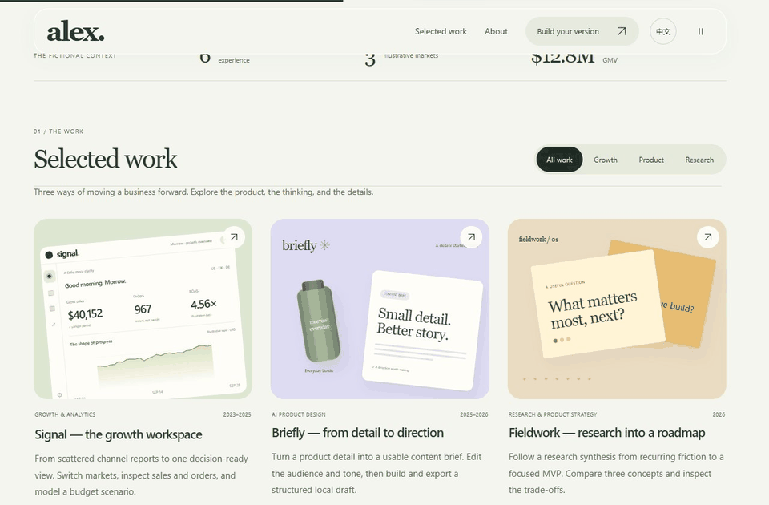
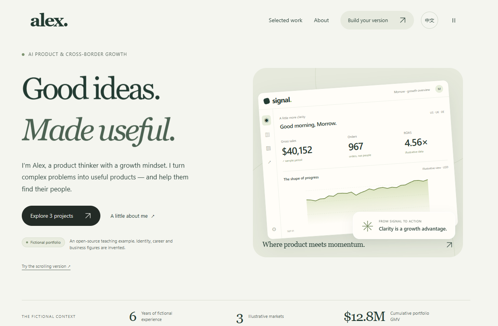
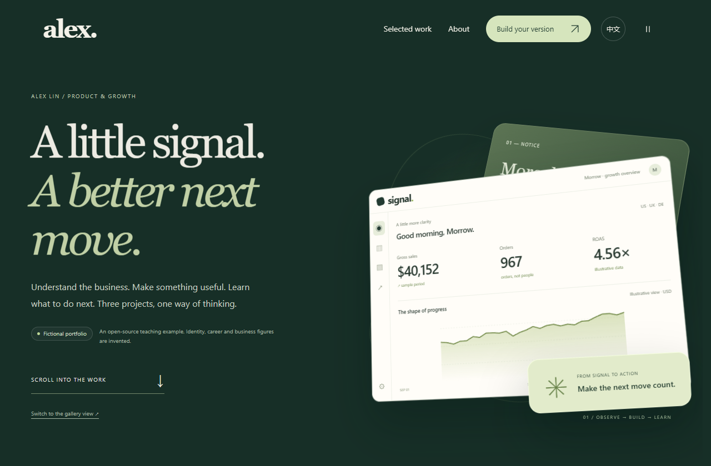
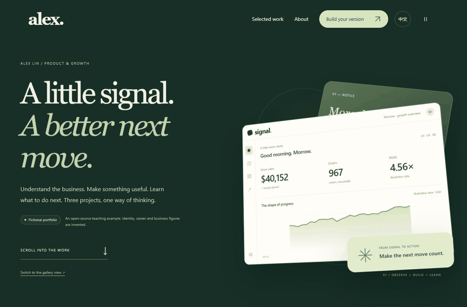
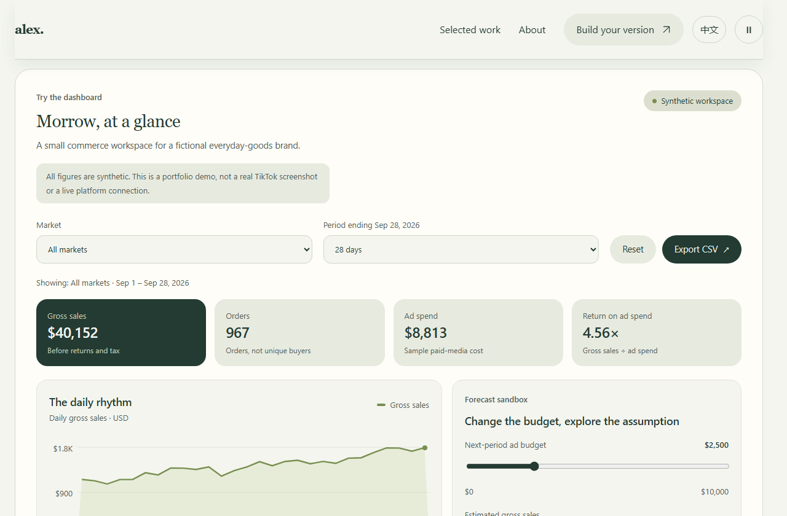
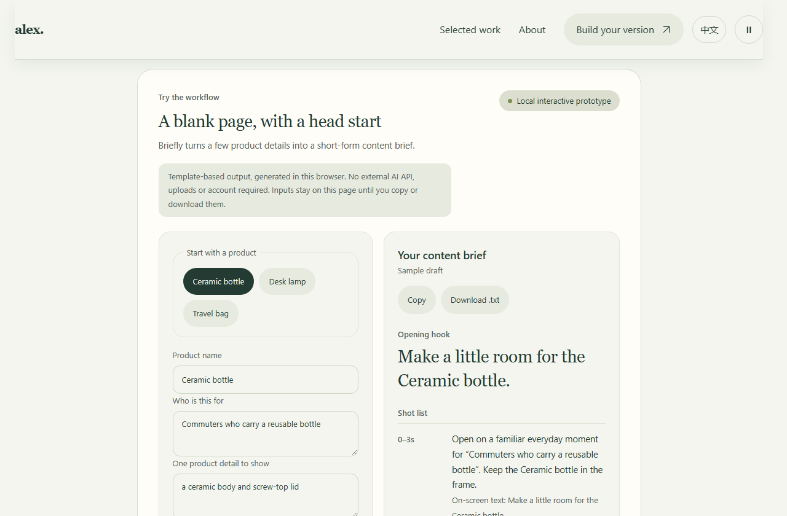
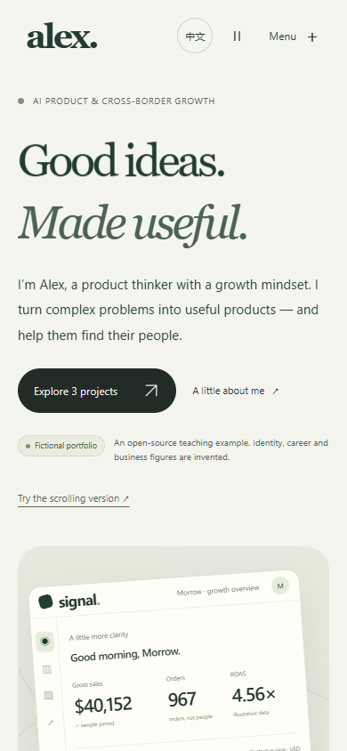
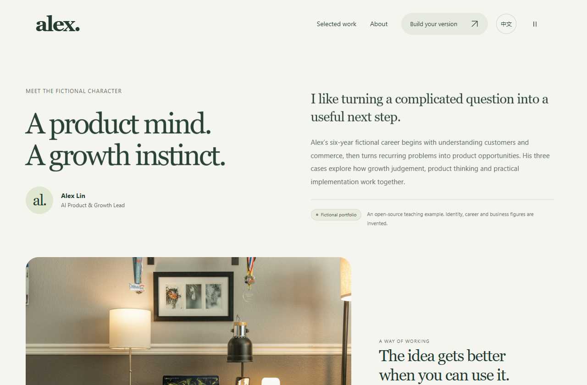

# Portfolio Lab

A portfolio Skill, with a bilingual website example you can run.

Give your coding agent a résumé, work samples, and the role you want. [portfolio-website](skills/portfolio-website/SKILL.md) helps it choose the work to show, explain your contribution, and build the site. The style and project count follow your material.

[简体中文](README.zh-CN.md) · [Install](docs/install.md) · [Troubleshooting](docs/faq.md)



[Watch the full demo, about 36 seconds](docs/media/portfolio-demo.mp4)

## Install

Use a coding tool that supports Skills, such as Codex, Claude Code, or Cursor. Send it this request:

```text
Install the portfolio-website Skill from
https://github.com/huang12chen/portfolio-lab/tree/main/skills/portfolio-website
in this project's Skill directory. Preserve any existing local edits, confirm the Skill is discoverable, and stop after installation.
```

Or run this in your project terminal, then choose your coding tool. Requires [Node.js 22.20+](https://github.com/vercel-labs/skills#install-a-skill):

```sh
npx skills add huang12chen/portfolio-lab --skill portfolio-website
```

The command installs to this project by default; add `-g` to use it across projects. For manual installation, confirmation, or updates, see [the install guide](docs/install.md).

## Make your portfolio

Send your résumé, work samples, and intended audience, then ask:

> Use the portfolio-website Skill. Build a portfolio for the role I am applying for. Choose which projects to show, explain my contribution, then design and build the site. Give me a preview and check the mobile layout and main controls.

In Codex you can invoke `$portfolio-website`; in Claude Code use `/portfolio-website`. [More requests](docs/examples.md)

## Example website

The same fictional résumé is presented in two versions so you can compare how they work.

| Gallery | Continuous scroll |
| --- | --- |
|  |  |

Alex Lin, the employment history, and the business data are fictional. Photo sources are listed in the [asset notes](examples/alex-lin/dist/ASSETS.md).



The three projects include these working controls:

- **Signal:** filter a commerce dashboard by country and period, change a budget scenario, and export CSV. Uses sample data.
- **Briefly:** enter product details, choose tone and duration, then build, copy, or download a content brief. Uses local browser templates.
- **Fieldwork:** compare three product proposals and read the reasons for choosing one.

| Signal dashboard | Briefly content brief |
| --- | --- |
|  |  |

<details>
<summary>Mobile and About pages</summary>





</details>

## Run the example

[Download the source ZIP](https://github.com/huang12chen/portfolio-lab/archive/refs/heads/main.zip), unzip it, and open the `portfolio-lab-main` folder. Run the command below there. The example needs Node.js 22+ and has no npm dependencies.

```sh
npm run dev
```

Open the [gallery](http://localhost:4180/index.html?lang=en) or [scroll version](http://localhost:4180/story.html?lang=en). Use the language control at the top right to switch languages. Ctrl+C stops the server.

## Edit and deploy

The example lives in `examples/alex-lin/dist/`:

- `data.js`: project descriptions and bilingual content.
- `app.js`: page structure.
- `demos.js`: project demo behavior.

Replace the sample career, projects, and numbers with your own material. For a different profession, ask the Skill to reconsider the pages as well as the writing; you do not need to keep Alex's role or style.

Images, fonts, and scripts are included locally. The site can use a static hosting provider or your own server. [Deployment guide](docs/deploy.md)

## Docs and development

[Usage examples](docs/examples.md) · [Teaching outline](docs/recording-guide.md) · [Recordings](docs/recordings.md) · [Release packages](docs/packages.md) · [Reviewing files before sharing](docs/privacy.md)

```sh
npm test
npm run check
npm run release
```

Questions and improvements are welcome; see [Contributing](CONTRIBUTING.md). Original code, Skill, and documentation use the [MIT license](LICENSE). Photo, font, and animation-library licenses are listed in [third-party notices](THIRD_PARTY_NOTICES.md).
